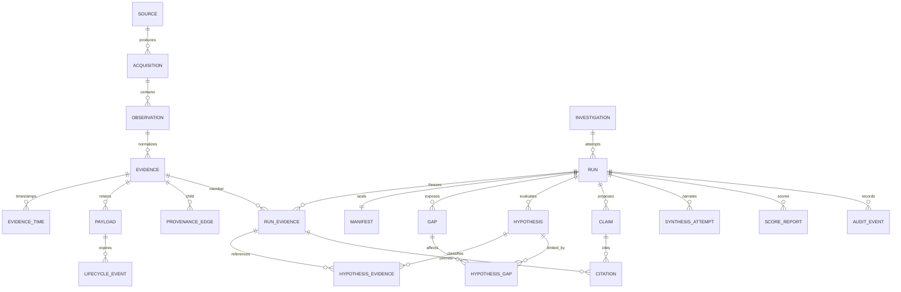

# PostgreSQL logical data model (Proposed)

Owner: Architecture lead. Decisions: CA-DEC-002/003/005. Issues: #2, #3, #5, #6, #8, #10. Trace: CA-FR-002/003/004/005/006/008/010/011/012; CA-NFR-001/002/004/005/010; CA-SEC-007/008/011. This is a logical schema specification, not executable DDL or a migration. Exact requirement/test mappings are in [traceability](traceability.md).

## Entity relationships

The manifest relationship applies to sealed runs; a collecting/failed-before-seal run has no manifest. Provenance has both parent and child evidence endpoints; the diagram labels the child endpoint for readability. Payload deletion retains a minimized artifact identity referenced by lifecycle events until metadata expiry.

## Proposed relations and keys

UUID means opaque run/control identity; stable evidence IDs are algorithm-versioned content/source identifiers, not source-provided IDs alone. All timestamps use UTC `timestamptz` where parsed; original text is retained separately. Nullable parsed times mean unknown, not epoch zero. Payload-bearing text is kept in the short-retention partition of the logical model.

| Relation | Key and essential attributes | Integrity and lifecycle requirements |
|---|---|---|
| source | source_id UUID PK; opaque cluster identity, source kind, namespace alias, query-registry version, classification | No credential values or arbitrary endpoint URL in evidence; source config references approved endpoint registry |
| acquisition | acquisition_id UUID PK; run_id FK, source_id FK, query ID/hash, window, status, cursor, coverage interval, truncation, retry count | Status one of complete/partial/empty/failed/denied; empty is never inferred from failure; cursor advances only after durable ingest |
| observation | observation_id PK; acquisition_id FK; source UID, opaque resourceVersion or query/sample key, transport-observed time, raw digest, digest-policy version | Unique source identity + source version/sample key + observation kind; digest is compared on retry, not included in the uniqueness key. A differing digest quarantines conflict; no last-write-wins |
| evidence | evidence_id text PK; observation_id nullable FK, kind, schema version, derivation-rule reference, source identity alias, payload_artifact_id | Either observed with observation link, or derived with versioned rule and parent edges; immutable after insertion; bounded payload is separate |
| evidence_time | (evidence_id FK, timestamp_kind, ordinal) PK; raw text artifact reference, parsed UTC, clock_domain, precision, offset estimate and its source, uncertainty bounds, quality | Record parse errors explicitly; lower <= upper when known; raw text and source labels follow payload retention |
| payload | artifact_id UUID PK; owner type/key, media type, sanitized canonical JSONB and/or exact sanitized bytes, size, digest, policy version, expires_at, availability | One artifact locator may remain after content is purged. No secrets admitted; retained bytes represent sanitized ingress, never a claim of complete original source data |
| provenance_edge | (child_id FK, parent_id FK, relation_type, rule_version) PK; derivation inputs/config digest | Both endpoints exist; no self derivation; reject derivation cycles in engine validation; provenance edge is not automatically a causal link |
| investigation | investigation_id UUID PK; scenario/version, window, initiator alias, created_at, scope/policy references | Stable investigation groups attempts; immutable requested scope; altered scope creates a new investigation |
| run | run_id UUID PK; investigation_id FK; attempt, parent_run_id nullable FK, state, stage, optimistic state_version, lease, timing, effective_policy_digest | Unique investigation + attempt; state updates via expected state_version; one active lease; state cannot indicate approval |
| run_evidence | (run_id FK, evidence_id FK) PK; membership ordinal, availability_at_seal | Frozen membership after sealing; unique ordinal per run; late evidence is a new run, not mutation of membership |
| manifest | run_id PK/FK; canonical bytes/digest, schema/rule/connector/scorer/fixture versions, ordered input IDs/digests, gap-policy digest, excluded volatile-field list, retention policy | Immutable and published transactionally with seal; input digest excludes run UUID/wall-clock timing; stored manifest tracks original availability, lifecycle overlay tracks current availability |
| gap | (run_id FK, gap_id) PK; expected source/query, type, time interval, detection rule, coverage, affected entity aliases | Types include missing/failed/out_of_scope/unverifiable/truncated/expired; generated deterministically; descriptive sensitive text in payload artifact |
| hypothesis | (run_id FK, hypothesis_id) PK; rule version, candidate/mechanism key, status, rationale artifact reference | Status unresolved/supported/contradicted/abstained/not_evaluated; computed by engine only; same run/versioned inputs yields same hypothesis ID |
| hypothesis_evidence | (run_id, hypothesis_id, evidence_id, relation) PK; rule/version, assertion key | Composite FK (run_id,hypothesis_id) and (run_id,evidence_id); relation supporting/contradicting/not_evaluated; no cross-run support |
| hypothesis_gap | (run_id,hypothesis_id,gap_id) PK; impact | Composite FKs to same-run hypothesis and gap; missing evidence never faked as an evidence node |
| claim | (run_id FK, claim_id) PK; synthesis_attempt nullable FK, claim type, text artifact reference, validation state, reason code | Untrusted candidate and validated result are distinguished; model text cannot set hypothesis status; rejected content expires with payloads |
| citation | (run_id,claim_id,evidence_id) PK; structured assertion/rule reference, validation result | Composite FK to same-run claim and run_evidence; existence alone does not establish semantic support |
| synthesis_attempt | attempt_id UUID PK; run_id FK, input-contract/prompt/model/policy digests, mode, timing, status, response artifact reference | No provider credential or hidden prompt payload in long-lived metadata; optional and may be disabled/failed without deleting deterministic bundle |
| score_report | (run_id FK, scorer_version, truth_digest, report_version) PK; counts, denominators, outcomes, exclusions | Append new report version for rescoring; scorer-only writes; truth payload is evaluator-only, outside engine views |
| audit_event | event_id UUID PK; run_id nullable FK, typed event, actor alias, timestamp, safe detail, policy version | Append via narrow writer; no raw payload, token, full personal identity or command text |
| lifecycle_event | event_id UUID PK; artifact_id, run/manifest digest reference, reason, authorization reference, effective time, purge state, retry metadata | Tombstone before/with access disablement; never use cascades to hide history; metadata purges after approved period |

## Transactions, access and canonical integrity

Acquisition inserts a bounded batch, observations, evidence and cursor in one transaction. Retry the same batch with its idempotency key; acknowledge only after commit. Coordinator seals an explicitly enumerated input set in a short repeatable-read transaction, verifies all selected ingest batches committed, inserts run_evidence and manifest, then compare-and-swaps the run state. No open transaction spans a source query or model call. A conflicting state transition aborts and retries under bounded policy; it cannot publish two authoritative manifests.

PostgreSQL JSONB is suitable for queryable payloads, but it does not preserve original JSON key order, whitespace or duplicate keys. Therefore reject duplicate keys at ingress and hash versioned canonical bytes; preserve exact sanitized byte artifacts separately when replay needs byte identity. This follows [PostgreSQL JSON type semantics](https://www.postgresql.org/docs/current/datatype-json.html). Composite foreign keys express same-run membership, and FK columns need deliberate index review rather than assuming automatic indexing, per [PostgreSQL constraints](https://www.postgresql.org/docs/current/ddl-constraints.html).

The proposed freeze transaction uses PostgreSQL's [repeatable-read snapshot behavior](https://www.postgresql.org/docs/current/transaction-iso.html), plus explicit membership and expected run state. It is not a claim that snapshot isolation alone prevents every cross-row race. Runtime roles cannot update sealed evidence/manifests; lifecycle role can clear payload content using narrow procedures after writing overlays. Metadata identity rows outlive payloads to prevent dangling provenance. At final metadata purge, delete dependents in a reviewed order and remove all retained run references; do not retain hashes prohibited by the deletion policy.

Proposed indexes: evidence source identity/version uniqueness; acquisition(run_id,source_id); evidence_time(clock_domain,parsed_utc); run_evidence(run_id,ordinal); provenance_edge(parent_id); hypothesis_evidence(run_id,hypothesis_id); gap(run_id,type); audit_event(run_id,timestamp); payload(expires_at,availability). JSONB GIN indexes require measured query justification; no broad index of raw log text. Capacity and index choices remain unbenchmarked.

Runtime database credentials are role-specific and injected outside Git. API reads through filtered views, engine cannot read ground truth or credentials, model has no database role, and scorer cannot alter evidence. Restrict privileges at relation/procedure level; process sharing still limits isolation. Hashes plus immutable roles are tamper-evidence against accidental/runtime misuse, not against host/database administrators. The [lifecycle contract](../../evidence-lifecycle.md) governs 30/180-day proposed periods and deletion overrides.

If a supposedly minimized manifest is later found to contain prohibited data or sensitive low-entropy digests, deletion policy takes precedence over retention: remove the affected manifest artifact and record only a privacy-safe unavailable/deleted receipt where authorized. Do not rewrite and silently re-sign its content. Historical replay then becomes unavailable; immutability is not a reason to retain prohibited data.
