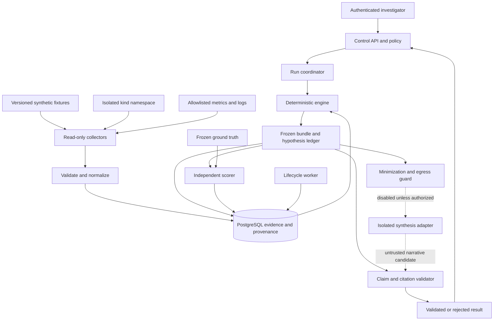
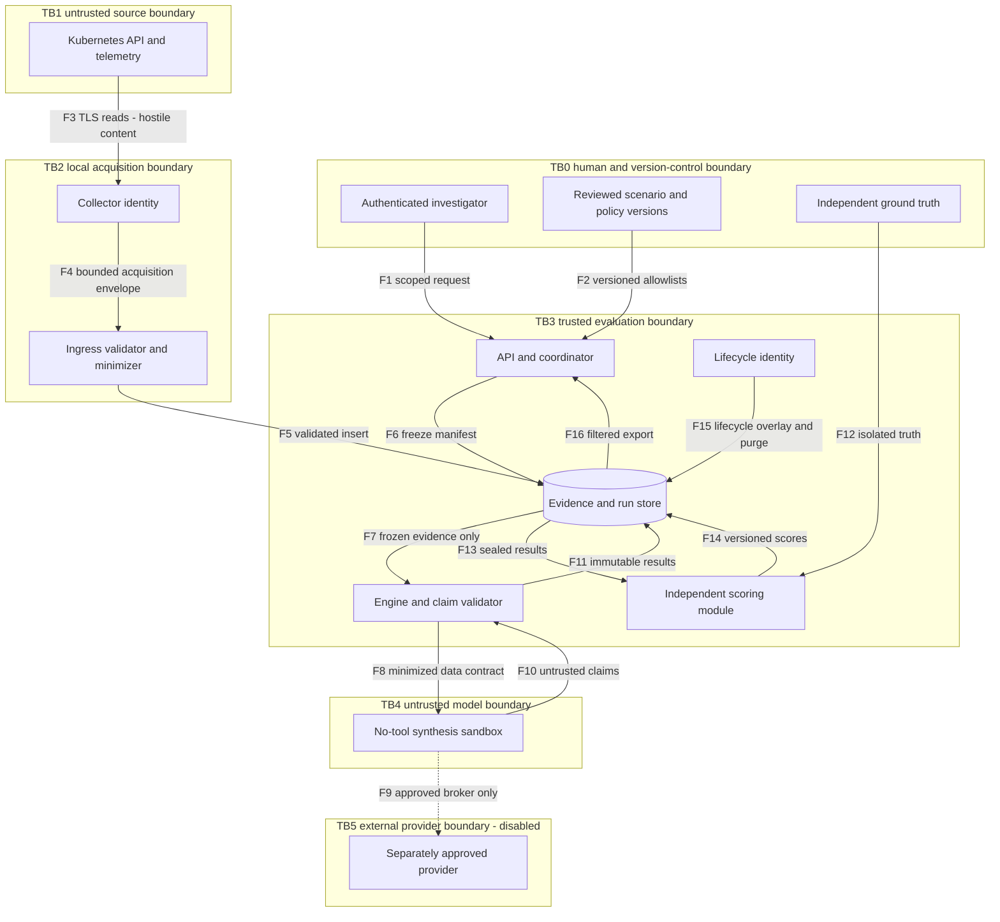
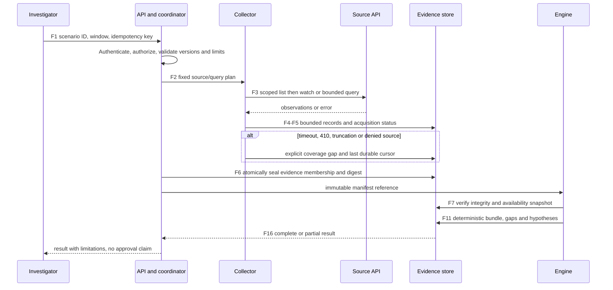
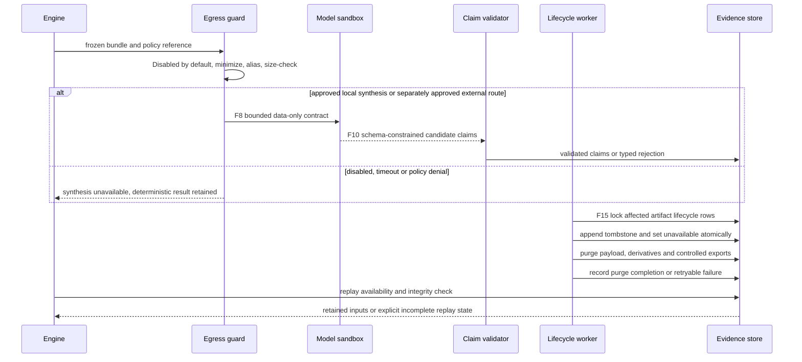

# Architecture diagrams and component responsibilities (Proposed)

Owner: Architecture lead. Trace: CA-FR-001 through CA-FR-014, CA-NFR-005, CA-SEC-001 through CA-SEC-012; exact mappings are in [traceability](traceability.md). All boxes and arrows are proposed, not deployed. Diagram source is Mermaid for repository review; rendered previews are in the diagrams directory.

| Diagram | Rendered preview | Vector / source |
|---|---|---|
| System components | [PNG](diagrams/system.png) | [SVG](diagrams/system.svg), [Mermaid](diagrams/system.mmd) |
| Data flows and trust boundaries | [PNG](diagrams/trust-boundaries.png) | [SVG](diagrams/trust-boundaries.svg), [Mermaid](diagrams/trust-boundaries.mmd) |
| Acquisition and freezing | [PNG](diagrams/acquisition-flow.png) | [SVG](diagrams/acquisition-flow.svg), [Mermaid](diagrams/acquisition-flow.mmd) |
| Synthesis and lifecycle | [PNG](diagrams/model-lifecycle-flow.png) | [SVG](diagrams/model-lifecycle-flow.svg), [Mermaid](diagrams/model-lifecycle-flow.mmd) |
| PostgreSQL relationships | [PNG](diagrams/data-model.png) | [SVG](diagrams/data-model.svg), [Mermaid](diagrams/data-model.mmd); details in [logical model](data-model.md) |

## System and component view

| Component / identity | Responsibility and owned state | Allowed access and prohibited authority |
|---|---|---|
| C1 Control API / api-reader | Authenticate investigator; validate scenario/window; enforce scopes; return filtered read models; record request audit | Can request runs through coordinator contract; cannot accept approvals, change truth or pass arbitrary URLs/SQL/model prompts |
| C2 Coordinator / run-writer | One bounded run lease; state machine, manifest versions, stage timing and idempotency | Write run state and orchestration audit; no cluster credential, arbitrary command or model-generated scheduling |
| C3 Collector / collector-reader | Fixed query registry, API TLS/source identity, cursors, acquisition status and minimized ingress | Only declared source reads; append through ingest contract; no control DB update, secret read, cluster write or model access |
| C4 Normalizer / evidence-writer | Schema/type/byte validation, source-qualified IDs, immutable evidence and timestamp provenance | Evidence insert transaction; cannot overwrite existing content or alter truth/approval records |
| C5 Engine / engine-worker | Freeze input set; deterministic timeline/relations/gaps; constrained hypothesis evaluation | Read frozen evidence and insert derived records; no live source, provider, arbitrary rule evaluation or truth access |
| C6 Store / postgres-service | Relational integrity, payload separation, fixed read models and run-manifest publication | Separate app roles; no runtime superuser; migrations belong to separately authorized maintenance |
| C7 Egress guard / egress-broker | Minimize and alias fields, enforce current signed-off policy reference and destination | No automatic enablement; only configured adapter destination after separate approval; never fetch model-supplied URLs |
| C8 Synthesis adapter / model-sandbox | Optional bounded transformation of supplied bundle into candidate claims | No Kubernetes/DB credentials, ground truth, shell, approval or general tool dispatcher; egress denied by default |
| C9 Claim validator / engine-worker | Reject unknown IDs, invalid schema, unsupported causal promotion and prohibited fields | Model never writes authoritative hypotheses; rejected output stays quarantined/minimized |
| C10 Scorer / evaluator | Compare sealed results with independently frozen truth; retain every failure | Read truth and frozen outputs; cannot change engine bundle or overwrite scored runs |
| C11 Lifecycle / lifecycle-worker | Evaluate expiry, tombstone before purge, remove payload copies, audit retries | Narrow deletion procedures and metadata view; no source/model access, risk acceptance or approval creation |

Engine, normalizer and coordinator are logical modules within the local trusted process initially; their database roles remain explicit design boundaries, not a claim of isolation against process compromise. Collector, lifecycle credentials and model process need separate execution contexts. Human fixture setup uses a different identity from all runtime components.

## Data-flow and trust boundaries

TB0 inputs are authorized only by authenticated role and pinned version, never by text claiming authority. TB1 TLS authenticates the endpoint, not the truth of its telemetry. TB2 ingress validation reduces disclosure but cannot make hostile text trustworthy. TB3 separates truth/scoring and lifecycle authority from reasoning. TB4 treats even a local model as untrusted computation. TB5 crosses organizational/data-retention control and is absent from the baseline network allowlist.

## Acquisition, freezing and failure flow

## Model and lifecycle flow

The [API contract](api.md) names envelopes for these flows; the [security coverage matrix](security.md) maps every F1–F16 flow to STRIDE threats and verification requirements.
