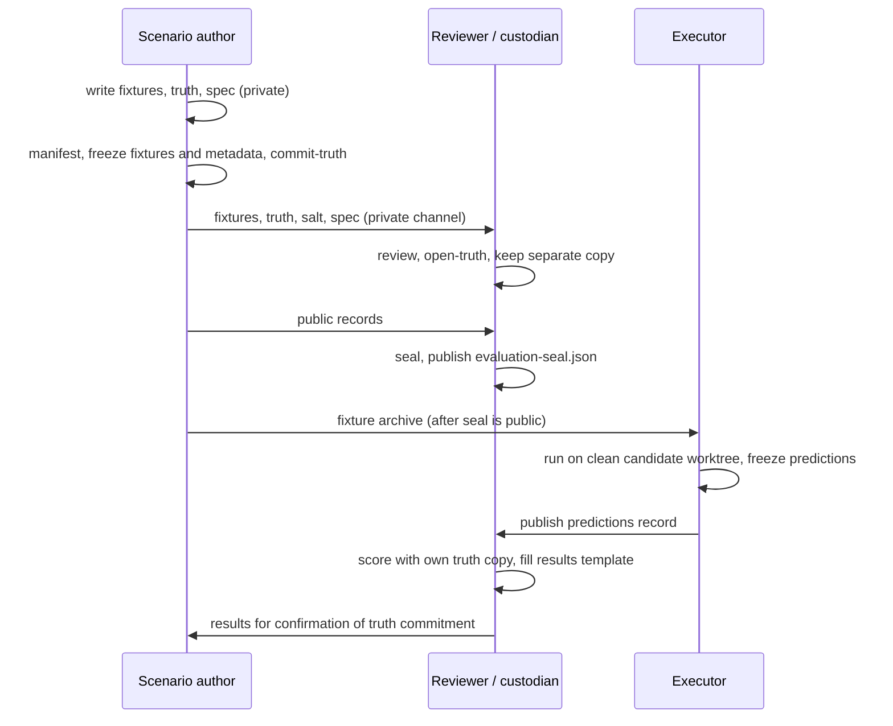

# Independent held-out evaluation authoring kit (CA-SCENARIO-008 to 010)

Status: exploratory evaluation kit. Using it does not approve any SSDLC gate, ADR or acceptance criterion. Owner of the process: evaluation reviewer under the [corpus plan](../../scenarios/corpus-plan.md).

Frozen evaluation candidate: `c21b50dc5edd6cd07de55d2f3e0bce6103b4d952` (engine `ca-spike-engine/0.2`, scorer `ca-scorer/0.2-spike`). Nothing in the engine, scorer, existing fixtures, truth pins or this kit changes after the seal is published.

## Kit contents

| Path | Purpose |
|---|---|
| [schema-reference.md](schema-reference.md) | Fixture and ground-truth data formats |
| [custody-and-freeze.md](custody-and-freeze.md) | Roles, separate truth custody, freeze-and-hash and seal procedure |
| [evaluation-process.md](evaluation-process.md) | Execution, scoring and how every outcome class is reported |
| [results-template.md](results-template.md) | Results report that lists every case |
| `templates/` | Blank per-family templates (spec, `fixture/`, `ground-truth/`, `metadata/`) for [008](templates/CA-SCENARIO-008/scenario-spec.md), [009](templates/CA-SCENARIO-009/scenario-spec.md) and [010](templates/CA-SCENARIO-010/scenario-spec.md) |
| `tools/heldout/heldout_kit.py` | Standard-library integrity tool: `manifest`, `freeze`, `verify`, `commit-truth`, `open-truth`, `seal`, `run`, `score` |

The templates contain no incident content. Every value is a `<<FILL: ...>>` placeholder, and the kit refuses to freeze any file that still contains one.

## Roles

| Role | Who | Must not |
|---|---|---|
| Scenario author | Independent of the engine author | Read the engine, scorer or development tuning material (below) |
| Truth reviewer / custodian | Independent of both author and engine author | Share truth before the predictions record is published |
| Executor | Anyone with the frozen candidate; may be the engine author | Receive truth, or change the candidate |
| Engine author | Wrote the candidate | See truth, fixtures or metadata before the seal is published, or alter anything after |

## Author restrictions

Before the seal is published, the scenario author must not read: `prototype/ca_spike/`, `prototype/ca_eval/`, `prototype/fixture_tools/`, `prototype/tests/`, `prototype/fixtures/*/README.md`, `docs/spikes/`, `docs/scenarios/CA-SCENARIO-001.md`, or the review discussion on PR #13. Those describe the candidate's behaviour or its tuning cases. This kit, the corpus plan, the SRS and the architecture documents are permitted. The author records this in the metadata attestation.

## What the scenario author does

1. **Set up a private workspace outside any Git checkout.** Copy `templates/CA-SCENARIO-00N/` for each family. Keep `ground-truth/` and the salt on storage only you and the reviewer control.
2. **Write the scenario specification** (`scenario-spec.md`): narrative, mechanism, distractors, preconditions, variants and the reasoning behind each expected answer. It stays private with the truth.
3. **Write the fixtures** in `fixture/` following [schema-reference.md](schema-reference.md): explicit resource identities (`source_uid`, `source_version`), declared clock domains with uncertainty, provenance in `source_ref`, at least variant `A`, and neutral variant descriptions that do not reveal answers. Delete any unused `*.TEMPLATE.*` files.
4. **Write the ground truth** by renaming `ground-truth/ground-truth.TEMPLATE.json` to `ground-truth.json` and filling every field, with one entry per variant.
5. **Self-check consistency**: every truth `source_ref` exists in the fixtures (or is listed as withheld), every variant has a truth entry, and every timestamp names a declared clock domain.
6. **Generate and freeze** (commands in [custody-and-freeze.md](custody-and-freeze.md#freeze-and-hash-procedure)): `manifest`, then `freeze --role fixtures`, fill and `freeze --role metadata`, then `commit-truth`.
7. **Hand to the reviewer** through a private channel: the fixtures, truth, salt and specification. The reviewer checks them and keeps an independent copy of the truth and salt.
8. **Seal together with the reviewer**: build the public seal directory, run `seal`, and publish `evaluation-seal.json`. Only then deliver the fixture archive to the executor.
9. **Wait.** Do not discuss the cases with the engine author until the results report is published.

## Sequence

