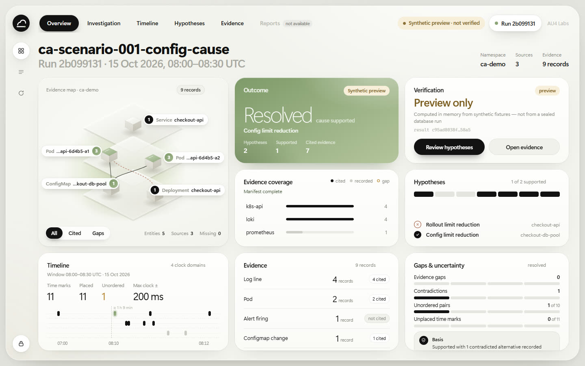
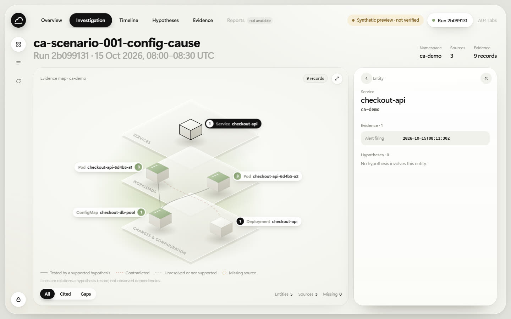
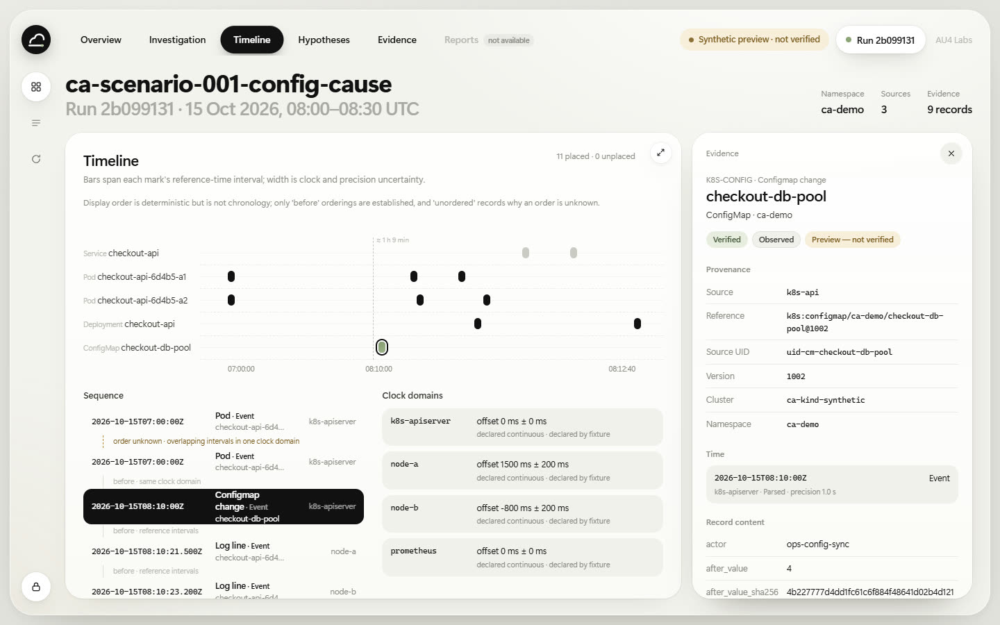
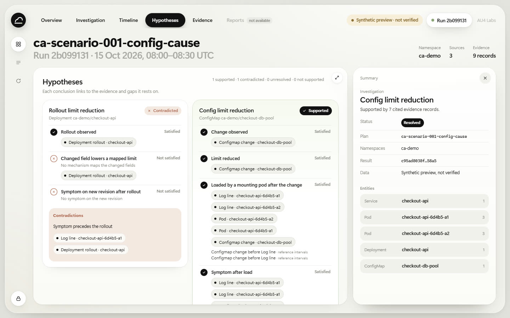
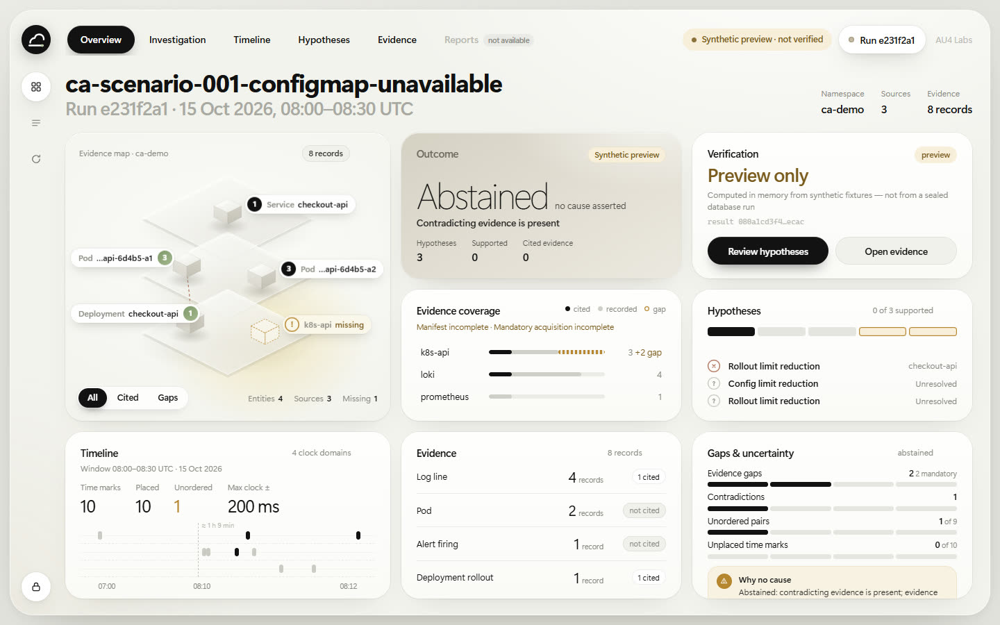
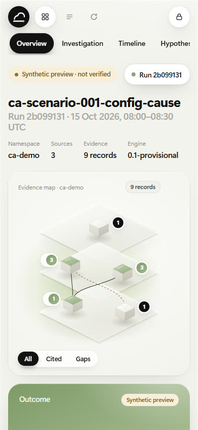

# CA-P2-006c — read-only investigation dashboard (implementation record)

**Scope:** the first dashboard for Cloud Autopsy. It is a read-only client of the [CA-P2-006b](ca-p2-006b.md) API, served same-origin by the existing loopback server. It is local, disposable and synthetic-only, under the product owner's [pre-gate development authorization](../ca-p2-003/ca-p2-003b-1.md).

**Not included:** write or remediation actions, new API routes, collectors, AI providers, customer data, deployment and reports (the Reports tab is shown as not available). This is not a gate approval, an evaluation result or a production-readiness claim.

## <a id="architecture"></a>Architecture

| Choice | Decision | Why |
|---|---|---|
| Framework | None: standard ES modules, CSS and inline SVG | No build step, no npm tree to pin, license or audit. The supply-chain inventory gains no component |
| Motion | Web Animations API with spring physics: a damped spring is simulated once per preset and sampled into a CSS `linear()` easing | Spring-based, interruptible layout transitions without a motion library |
| Layout transitions | FLIP: measure every card, switch the grid state, measure again, then animate from the old geometry | The expanding card is the same element throughout, so the centerpiece keeps continuity instead of cross-fading between screens |
| Serving | `ApiService(..., ui=ui.load_assets())`: a fixed table of nine files read into memory at start | No request path is ever joined to a filesystem path; unknown paths are `404` as before |
| Data | Only the existing `/v1` routes: `result` and `citations` per run, `evidence/{hex}` on demand | No new backend routes or dependencies |

Files: `src/cloud_autopsy/api/ui.py` and `src/cloud_autopsy/api/ui/` (`index.html`, `app.css`, `app.js`, `dom.js`, `motion.js`, `model.js`, `topology.js`, `views.js`, `icon.svg`).

## <a id="experience"></a>What it shows

- **Overview:** a composition of eight cards around a central evidence map.
  - Outcome card: sage only when a hypothesis is supported; neutral stone and "no cause asserted" when the engine abstained.
  - Verification card: "Byte-identical replay" only when the API envelope says `verified: true`.
  - Evidence coverage per source, with gaps.
  - Hypotheses, with a segmented bar of prerequisite results.
  - Compact timeline, evidence by kind, and gaps and uncertainty with the abstention reasons.
- **Evidence map (hero):** an isometric, three-tier view (services, workloads, changes and configuration) of the entities that appear in the run's evidence.
  - A line is drawn only where a hypothesis tested that relation, styled by the hypothesis's status. The legend says so: lines are not observed dependencies.
  - A source the plan needed but could not read is a hollow, dashed "missing" node.
- **Focused views:** clicking the map, a card or a navigation pill expands that card into the workspace, the other cards make way, and the inspector slides in. Escape, the close button or Overview reverses it.

  | View | Focused card shows |
  |---|---|
  | Investigation | The map with a summary, entity or gap inspector |
  | Timeline | One lane per entity. Each bar spans a time mark's reference interval; width is clock and precision uncertainty. Long empty stretches are compressed into a labelled break ("≈ 1 h 9 min"). Marks with no reference time sit in a separate "unplaced" tray and are never positioned. Adjacent pairs are labelled `before` or `order unknown` with their basis |
  | Hypotheses | Every prerequisite with its result, reason, evidence and gap chips, orderings and contradictions |
  | Evidence | All sealed members, filterable by source or citation |
  | Gaps & uncertainty | Gaps, contradictions, unordered pairs and unplaced marks |

- **Evidence inspector:** source identity, provenance, times and clock domain, coverage, record content, the hypotheses that cite it, and its digests. A log message is shown in a block labelled as untrusted source text.
- **States:** loading, `401` (the token is cleared and the sign-in sheet returns), `403`, `404`, `409` (with the verification reason), `503` overloaded (paced retries after `Retry-After`, then shown), API unreachable, and a result-digest mismatch between two responses. Every error state clears all run content from the screen.

### Screenshots (synthetic preview)

| | |
|---|---|
|  |  |
| Overview, resolved run | Investigation focus with the entity inspector |
|  |  |
| Timeline focus with an evidence record | Hypotheses with linked evidence |
|  |  |
| Abstained run with a missing source | 390 px wide |

## <a id="security"></a>Security controls

- **Same origin, loopback only.** The page is served by `LoopbackServer` on `127.0.0.1` and talks only to `/v1` on the same origin (`fetch` with `mode: "same-origin"`, `credentials: "omit"`, `redirect: "error"`, `cache: "no-store"`).
- **Strict page policy:**
  - `default-src 'none'`; scripts, styles and images from `'self'` only; `connect-src 'self'`.
  - No inline script or style, `frame-ancestors 'none'`, `form-action 'none'` and `base-uri 'none'`.
  - **Trusted Types enforcement** (`require-trusted-types-for 'script'; trusted-types 'none'`), so no string can reach an HTML sink.
  - Also `X-Frame-Options: DENY`, `Cross-Origin-Opener-Policy` and `Cross-Origin-Resource-Policy: same-origin`, and `no-store`.
- **Untrusted text stays text.** All DOM is built with `createElement` and text nodes (`dom.js`). The offline tests reject `innerHTML`, `outerHTML`, `insertAdjacentHTML`, `document.write`, `eval` and similar in the source. A browser test serves a record whose message is HTML and script, and checks that it renders as literal text and never executes.
- **Token handling:**
  - The bearer token lives only in a module variable. It is never written to storage, cookies, the DOM or a URL; the password field is cleared on submit.
  - A `401` clears it. The lock button clears it on demand.
  - The browser tests check storage, cookies, the URL and the serialized DOM.
- **Authorization and verification are unchanged.** Per-run grants, `403` before the database, verify-on-read and the concurrency gates all apply to the dashboard's requests exactly as to any client. The dashboard paces itself to two requests in flight.
- **Never stronger than the data.**
  - "Verified" appears only for `verified: true`.
  - The sage treatment and "Resolved" appear only for `outcome.status == "resolved"`.
  - Unknown keys are shown verbatim, not hidden.

## <a id="preview"></a>Synthetic preview (no database)

`python -I tools/dashboard_preview.py` serves the same page and the same `ApiService` (tokens, grants, limits) on `127.0.0.1:8766`. The results are computed in memory by the engine from the six fixture variants, not read from a sealed run.

- Every envelope says `"verified": false` and `"data_source": "synthetic-preview"`.
- The dashboard shows "Synthetic preview · not verified" and "Preview only" everywhere.
- A disposable token is generated per start into a private directory under the system temporary directory, outside any Git working tree. The command prints the path of that file, not the token. The directory is removed on a normal exit; a forced kill leaves it in the temporary directory.

For verified results, `tools/api_demo.py` or `python -m cloud_autopsy.api.server` serve the same dashboard at `/`.

## <a id="tests"></a>Tests

- **Offline** (`tests/api/test_dashboard_offline.py`, 17 tests):
  - every asset is served with its type and the page policy;
  - the asset table is fixed, so traversal, unknown and query paths are refused;
  - API responses and their `default-src 'none'` policy are unchanged; a service without assets serves no page;
  - ASCII-only assets; no HTML sinks, dynamic code, browser storage or URL state; only same-origin requests; no inline script, style or handlers;
  - the preview is labelled not-verified, keeps tokens and grants, and stores its secrets outside the repository.
- **Browser** (`tests/browser/test_dashboard_browser.py`, 13 tests, headless Chrome or Edge over a standard-library DevTools client in `tests/browser/_cdp.py`, real mouse and keyboard input):
  - sign-in validation and token hygiene;
  - the preview labelling;
  - hero expand and collapse: the card grows by more than 40 % in each dimension, the inspector appears, and Escape restores the exact geometry;
  - interrupted transitions settle into one consistent layout;
  - timeline selection opens the evidence inspector; hypothesis chips open evidence, and Back returns;
  - an abstained run never shows sage, supported relations or a cause;
  - hostile evidence text stays inert;
  - the layered cards' morph, stepped every 30 ms: compact and expanded content never show together, the card in flight stays above the inspector, and rapid toggling, switching cards and resizing mid-transition all end in the exact original geometry with no leftover animation state (see [polish](#polish));
  - refusals show no run content;
  - no horizontal scroll at 390, 768 or 1024 px;
  - reduced motion switches views without transform or size animation.

  Every test also fails on CSP violations or console errors.
- **Real PostgreSQL** (`tests/integration/test_api.py`): the dashboard served by `server.build` against the disposable database shows "Verified on read", "Byte-identical replay" and "Served after verification" for database-verified results, including an abstained run.
- **Demo:** `tools/api_demo.py` adds a `dashboard` check: every asset is `200` with the page policy.

CI runs the browser tests in the offline job and the database-backed browser test in the integration job, both with `CA_BROWSER_REQUIRE=1`, so a missing browser fails the run instead of skipping. Hosted runners use their preinstalled Chrome with `--no-sandbox` (`CA_BROWSER_NO_SANDBOX=1`), because the runner may forbid the sandbox's namespaces. The browser loads only the loopback page under test.

## <a id="polish"></a>Polish (PR #25 review)

| Finding | Confirmed cause | Fix |
|---|---|---|
| The Gaps & uncertainty card's content overlapped or flashed on collapse | Measured on stepped frames: in `morphLayers`, the outgoing layer's 170 ms fade had no fill. It snapped back to full opacity while still displayed for the rest of the morph (about 600 ms), so both layers drew at once (up to opacity 1 + 1). Separately, a card in flight (`z-index: 4`) passed under the inspector (`5`) when returning to the inspector's column, which Gaps and Hypotheses do. Gaps showed it most: it is the densest card and returns there last | The outgoing fade holds at 0 (`fill: "forwards"`). `afterTransition` cancels every layer animation, so no held state outlives a transition. A card in flight is lifted above the inspector (`z-index: 6`). Motion, timing and easing are unchanged |
| The scrollbar was too heavy for the inspector | The browser default: 10 px, dark, with arrow buttons | 4 px, fully rounded, translucent warm-grey thumb with a soft inner gloss on a transparent track, a slightly firmer hover. Applied to the inspector, the expanded cards, the run list and the sign-in text area. Firefox gets the thin standard scrollbar in the same colours. The hidden navigation scrollbar and the timeline controls are untouched |

The regression test fails on the previous code with 60 failing frames (48 overlapping, 12 under the inspector) and passes with the fix, as does the same check at 1024 px.

## <a id="reference"></a>Fidelity to the visual reference

The product owner's reference video defined the visual and motion target. The dashboard adapts it without its subject matter:
- **Surfaces:** a pearl window with large radii, soft borders, ambient shadows and glossy highlights.
- **Accent:** one sage card for a supported finding.
- **Navigation:** black pill selections, a minimal icon rail and floating markers over the centerpiece.
- **Transitions:** the focused card grows over its neighbours while they make way, the inspector arrives from the right edge, and the whole sequence reverses.

Known differences:
- **The centerpiece is a lit SVG sculpture, not a rendered 3D model.** It is generated from the run's data, so it stays truthful and dependency-free.
- **The page uses the platform's system font stack;** no font is bundled.
- **Motion was tuned on frames captured with the animation timeline paused and stepped at 33 ms;** the recording in the PR was made the same way.

## <a id="run-it"></a>Run it

```bash
python -I tools/dashboard_preview.py
```

Open `http://127.0.0.1:8766/`. Paste the token from the printed file path and the printed run IDs.

## <a id="risks"></a>Unresolved risks and limitations

- **Bearer token in page memory.** Any script running in the page could read it. The CSP and Trusted Types allow only this origin's own modules, and there is no third-party code, but there is no further isolation. The token travels over plain HTTP on loopback, as for every API client (see [CA-P2-006b](ca-p2-006b.md#risks)).
- **No run listing.** Run IDs are entered by hand; there is no discovery route, by design for this slice.
- **Two requests per run open.** Opening a run costs two full verifications (`result` and `citations`), and each evidence record one more. Evidence is cached per run and result digest for the page's lifetime only.
- **Browser coverage.** Automated tests run on Chromium-family browsers only. Safari and Firefox were not tested; the CSS `linear()` easing falls back to a cubic curve where unsupported.
- **Visual review is not a usability study.** Layout and motion were checked by screenshots and stepped frames, not with users.
- **Inherited:** every risk recorded for [CA-P2-006b](ca-p2-006b.md#risks) and [CA-P2-006a](ca-p2-006a.md#risks).
