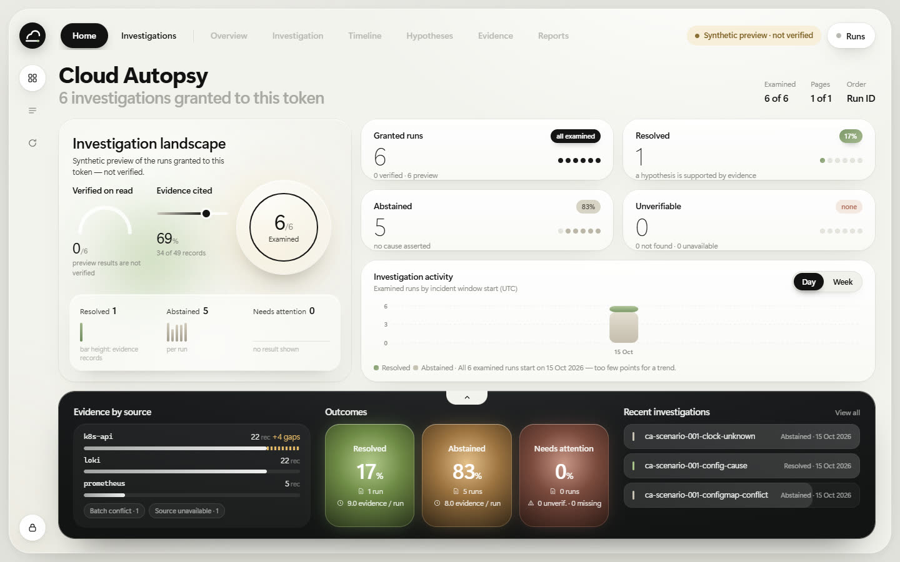
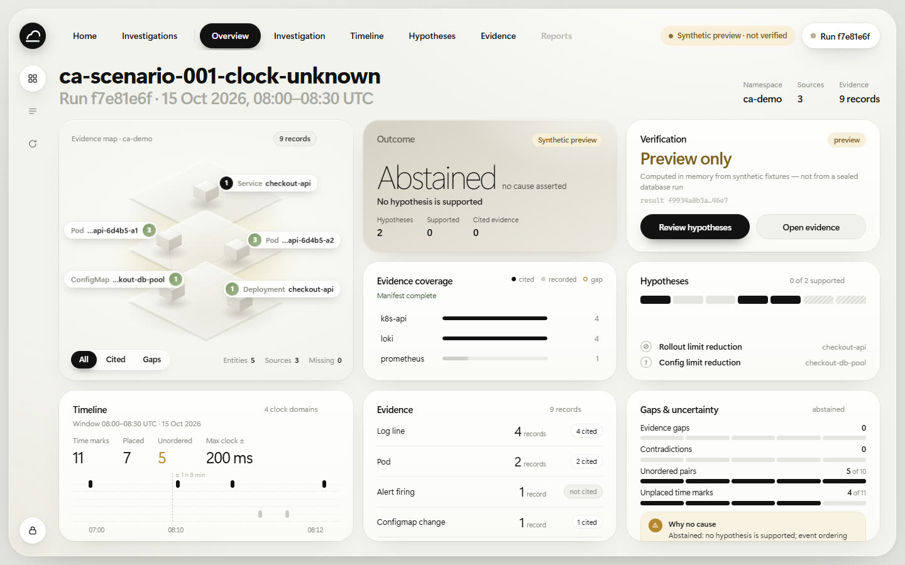
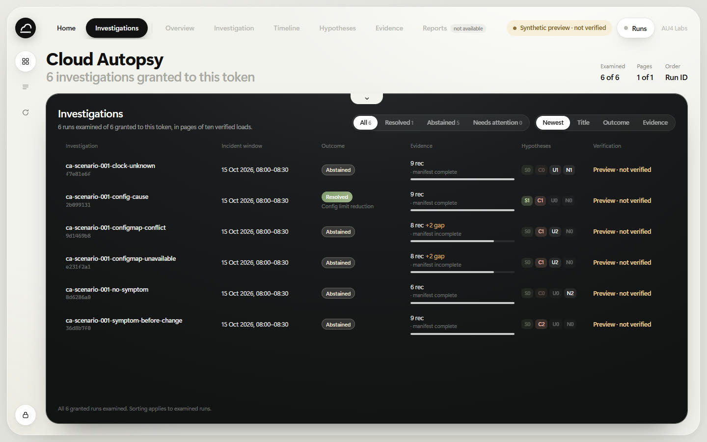
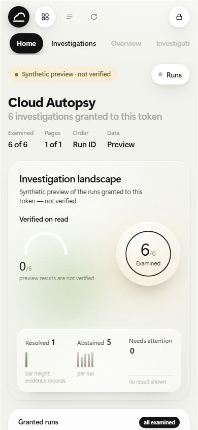

# CA-P2-006d — Home and run summaries (implementation record)

**Scope:** a Home / platform overview for the [CA-P2-006c](ca-p2-006c.md) dashboard. It summarizes the investigations granted to the current token, plus the smallest read-only API extension it needs. It is local, disposable and synthetic-only, under the product owner's [pre-gate development authorization](../ca-p2-003/ca-p2-003b-1.md).

**Not included:** write endpoints, run discovery beyond the token's own grant, server-side aggregation across pages, changes to the engine, evidence contracts, database schema or the existing investigation workspace's design. This is not a gate approval, an evaluation result or a production-readiness claim.

## API extension: `GET /v1/summaries/{page}`

The `/v1` API was run-ID based with no discovery. One route was added; nothing else changed.

| Property | Behaviour |
|---|---|
| Scope | Only the run IDs in the caller's own grant. There is no global listing, and a token never sees another grant's runs |
| Order and pages | Run-ID order (grants are sets, with no other stable key); `SUMMARY_PAGE_SIZE` = 10 per page; `page` is 1–9999 without leading zeros (`400`); past the end gives `404 page_not_found` |
| Verification | Every run on the page goes through the same verify-on-read loader as `/v1/runs/...`. Only a verified (or labelled preview) result contributes fields |
| Failures | Reported by state only, never with data: `unverifiable` (with the stable reason, for example `replay_mismatch`), `not_found`, or `unavailable` (database down) |
| Workload | A page request holds **one** slot of the existing verified-read gate and verifies its runs one after another (one database connection at a time). Work per request is bounded at 10 replays, and the gate's limits still hold; a full gate gives `503 overloaded` |
| Response | Per run: plan ID, incident window, outcome (status, mechanism, reasons), manifest status, evidence records and cited by source, gaps (total, mandatory, reasons), hypothesis status counts, unplaced marks and unordered pairs, and the result digest. All fields are read from the verified document. The envelope carries `granted_total`, `page`, `pages`, `page_size` and `order` |
| Aggregation | None on the server. Totals belong to the client, which knows exactly how many runs it examined |
| Preview | Items carry `"state": "preview"`, `"verified": false` and the envelope `data_source: "synthetic-preview"` |

## Home

The sign-in sheet now needs only the token. Run IDs are optional and open those runs directly. Home loads up to five pages automatically (50 runs, 50 bounded verifications) and offers **Load more** for the rest.

- **Hero, "Investigation landscape":**
  - a verified-on-read gauge: verified of examined, so 0 in preview;
  - the share of evidence records that hypotheses cite;
  - an orb with runs examined of runs granted;
  - a glass panel grouping runs into resolved, abstained and needs attention, with one bar per run whose height is that run's evidence count.
- **Metric cards:**
  - granted runs;
  - resolved;
  - abstained;
  - unverifiable, with not-found and unavailable counted alongside, never as outcomes.

  Each card has one dot per examined run, highlighting the runs it counts.
- **Investigation activity:** examined runs by incident window start, by day or week, stacked by outcome. A connecting line is drawn only with three or more points. Otherwise the caption says there are too few points for a trend. In the synthetic data all six runs share one window, and the chart says so.
- **Charcoal band:**
  - evidence records and gaps by source, with gap reasons;
  - outcome tiles with the share of examined runs and average evidence per run;
  - the most recent investigations by incident window.

  The notch or **Investigations** expands the band into a full table of examined runs:
  - filter by all, resolved, abstained or needs attention, and sort by newest, title, outcome or evidence;
  - each row shows evidence completeness, hypothesis counts and verification state.

  Opening a row opens the existing workspace.
- **Honesty rules:**
  - Every figure says "examined". When not every granted run is loaded, the table says so, and sorting applies only to examined runs.
  - Runs without a verified result are never counted as outcomes and never dated.
  - No titles, dates or trends are invented: titles are plan IDs, dates are verified incident windows.

### Screenshots (synthetic preview, 1440 × 900 unless noted)

| | |
|---|---|
|  |  |
| Home | Investigation detail, same viewport |
|  |  |
| Investigations (expanded band) | Home at 390 px |

## One design system

Home is built on the workspace's existing tokens and primitives:
- the window, rail and title bar;
- the card radius, surfaces, shadows and type scale;
- `.segmented` and `.btn` controls, the scrollbar treatment, and the sage, stone, amber and rose status colours;
- the spring presets and FLIP morph from `motion.js`, including the layer-fade fix from the PR #25 review.

The only new tokens are the charcoal band and glass values. The workspace's design, layout, evidence map and animations are unchanged. Its only edits are navigation-related:
- **Home** and **Investigations** pills before the run views; run views are disabled until a run is open;
- the rail's first button now goes Home;
- optional run IDs at sign-in;
- below 1600 px the org label and the "not available" note are hidden so the wider navigation fits.

Home uses its own `h-layer` classes, so no workspace selector or test sees it.

## Security

Unchanged from CA-P2-006c:
- loopback only;
- the strict page policy with Trusted Types;
- the token in memory only;
- text-node DOM;
- read-only `ca_engine` access;
- verify-on-read.

Home calls only `/v1/summaries/{page}` through the app's existing queued client, at most two requests in flight. The offline tests check that it makes no other request.

## Tests

- **Offline** (`tests/api/test_summaries_offline.py`, 8 tests):
  - only the token's runs;
  - authentication and page format;
  - bounded, disjoint pages that cover the grant exactly once, with one verification per listed run and no more;
  - failure states with no data;
  - figures equal to the verified result's own;
  - a page takes one gate slot (`503 overloaded` when full, with no backend call);
  - preview items never verified;
  - the access-log template.

  `test_dashboard_offline.py` also checks that Home requests only the summaries route.
- **Browser** (`tests/browser/test_dashboard_browser.py`, Home tests):
  - token-only sign-in opens Home, and every card's figure equals the figure computed independently from the API response, including a not-found run kept out of outcomes;
  - filtering, sorting and opening a run, then Home again;
  - the Investigations morph reverses to the exact geometry and Escape returns;
  - no horizontal scroll at 390, 768 and 1024 px.
- **Real PostgreSQL** (`tests/integration/test_api.py`):
  - summaries list exactly the grant's runs, with verified digests equal to the stored ones and the unknown run `not_found`;
  - Home in a browser against verify-on-read shows "Verified on read" and opens "Byte-identical replay".

## Polish (PR #26 review)

Each issue was reproduced in a headless browser before it was changed. The browser tests now step the page transitions frame by frame and check that content is visible after scrolling into view, not just present in the DOM.

| Issue | Confirmed cause | Fix |
|---|---|---|
| KPI card footers clipped (1.4–6 px at 1440×900, about 1694×900 and 125 % zoom) | Home rows were `minmax(94px, 0.66fr)` inside a fixed-height window, and every card is `min-height: 0; overflow: hidden`. Rows never grew to fit their content | The KPI and band rows are `minmax(max-content, …fr)`, so a row is never shorter than its content |
| Outcome tiles, chips and recent rows cut off (15–23 px at about 1366–1694 × 730–780 browser heights) | The same grid, when the rows' needs exceeded the window, overflowed and was clipped by `.window { overflow: clip }` | On desktop widths Home fills the window with a definite floor (`min-height: 660px`, the sum of the row minimums); when the viewport is shorter, the window's content area scrolls with the existing slim scrollbar instead of clipping. At 1440×900, 1694×900 and 1920×1042 everything fits without scrolling. Narrower layouts already scroll the page and are unchanged |
| Detail → Home showed a blank frame, then the expanded Investigations layout morphing back | `showPage()` faded the old page fully out before showing the new one (a blank gap), and `goHome()` applied the requested Home view only after the reveal, so Home appeared in its previous view and then morphed | The destination is prepared before it is shown (`goHome()` sets the Home view instantly in a `prepare` step; opening a different case shows a neutral loading skeleton, never the previous case). The pages crossfade with the outgoing page held in place, so one page is always clearly visible. An interrupted Investigations morph now always clears its in-flight state (`clearMorph`); before, rapid navigation could leave the band stuck mid-morph |
| Charcoal band flickered when expanding or collapsing: its content darkened or disappeared for about 120 ms | The outgoing layer faded out over 170 ms while the incoming layer waited 110 ms and then faded in on a spring. Between 90 and 210 ms neither layer was above 0.6 opacity (0.04 and 0.15 at 150 ms), so the band showed little but its background. During the morph the band is `overflow: visible` (for the notch), so the full-size incoming layer could also spill past the band's edge. The finished morph then rebuilt the band, and an interrupted morph restarted both layers from full strength | A short, offset linear crossfade: the incoming layer fades in over 160 ms from its current opacity, and the outgoing layer starts 40 ms later, sooner when a reversed morph's incoming content is already partly visible. The stronger layer stays above 0.6 and the two never sum above about 1.25. The band clips its layers while morphing (`overflow: clip`). The finished morph keeps its visible nodes, emptying only the hidden table. Reduced motion swaps the content directly. The spring size morph, the content slide and the card recession are unchanged |
| White Home cards flashed and settled unevenly as the band expanded or collapsed | The band's animated height (and its layers going `position: absolute` while morphing) re-flowed the Home grid's `max-content`/`fr` rows. The white cards changed size throughout the morph (the landscape card 407 → 437 px, snapping back to 422 px at the end), and every size change made the activity chart's resize observer rebuild the chart, replaying its bar-growth animation. One collapse rebuilt it 14 times, so its bars vanished and regrew | While the band morphs, the grid's rows are pinned to their resting sizes (`grid-template-rows` set inline from the computed rest layout, cleared with the rest of the morph state). The white cards keep exactly their final geometry and only their existing transform and opacity springs move them. A size-only chart redraw no longer replays the bars' growth |
| Faint secondary text on the KPI cards | `--muted` on white was used for descriptions | A slightly darker `--muted-strong` (#6f6e67) for KPI descriptions, the trend subtitle and gauge notes; the hierarchy is unchanged |

Regression tests in `tests/browser/test_dashboard_browser.py`:
- **Transitions, stepped every 30 ms:** Detail → Home and Detail → Investigations land directly with no blank frame; switching cases never shows the previous case.
- **Stress:** rapid, interrupted navigation with a resize settles into one consistent layout; reduced motion changes pages without movement.
- **Band crossfade, stepped every 30 ms:**
  - repeated expand and collapse, including collapse through the Home pill, never drops the stronger layer below 0.6;
  - the two layers never sum above 1.3, and no layer is drawn outside the band;
  - the finished morph keeps its nodes;
  - an interrupted morph reverses from its current opacities, and rapid clicks with a resize settle into a clean band;
  - with reduced motion the content swaps directly.
- **White cards, stepped every 30 ms**, at 1440×900 and at 1152×720 with 125 % zoom:
  - **while visible:** each of the six cards keeps its exact layout box, its chart never replays, and its opacity never jumps more than 0.35 between frames;
  - **coverage:** repeated expand and collapse through the notch and the Home tab, double reversals, and rapid tab switching with a resize;
  - **end state:** every card returns to its exact rest geometry (compared with a fresh load at that size) with no stale inline styles;
  - **reduced motion:** the cards return directly at full opacity.
- **Visibility:** KPI footers and values, all three outcome tiles, chips and recent rows are visible at 1440×900, 1694×900, 1920×1042, 1152×720 at 125 % zoom, 1694×780, 1366×768, 1024×900 and 768×1024. The full desktop heights fit without scrolling.

## QA remediation slice 1

These fixes follow the browser QA audit of `d183345`. Its report, `out/qa/QA-REPORT.md`, is local and not committed. Each issue was reproduced before the change.

| Finding | Confirmed cause | Fix |
|---|---|---|
| QA-01 (P1): workspace overview cards clipped content by 11–75 px at 1440×900, about 1694×900 and 1366×768 ("Why no cause" / "Basis", Evidence and Timeline) | On desktop the stage rows were `minmax(0, …fr)` inside the fixed-height window, and cards are `min-height: 0; overflow: hidden`, so a row never grew to fit its card | On desktop the overview's rows are `minmax(max-content, …fr)`, and the window's content area scrolls when the viewport is shorter. Focus mode keeps its rows, so expanded cards still fit the window. The hidden inspector is `contain: size`, so it never sizes the rows. While a card collapses, the rows are held at the final layout, and card geometry is measured against the (possibly scrolled) content area, so no card re-flows or jumps |
| QA-02 (P2): Clear token left the previous results in the page; late responses could reach a new session | Sign-out only dropped the token and the evidence cache. Requests had no session identity, so a late page of summaries or a late run result could land in the next token's session | `clearSession()` ends the session: in-flight requests are aborted, and every late or queued response is discarded as stale (`request` checks a session generation before fetching and after reading the response). It removes run results, citations, the evidence cache, Home's summaries, the workspace, inspector, header, run list, view state and toasts. Home's loader drops pages from an ended load. Authentication and authorization semantics are unchanged; the token stays in memory only |
| QA-03 (P2): the run switcher's open state was not exposed | The trigger had `aria-haspopup` but no `aria-expanded` or `aria-controls` | Both triggers (the run pill and the rail's Runs button) carry `aria-controls="runs-popover"` and an accurate `aria-expanded`. Arrow, Home and End keys move through the runs. Escape and selection return focus to the button that opened the list |
| Contrast: secondary text below WCAG AA | `--muted` #8b8a84 was about 3.1:1 on the window colour. The run subtitle #a9a8a2 was about 2.1:1. Dark-band secondary text (white at 34 %) was about 3.1:1. Some meaningful labels used `--faint` | `--muted` is #6f6e67 (4.6:1 on the window colour, 5.1:1 on white). The large semi-bold run subtitle is #82817b (above 3:1). Dark-band secondary text is white at 50 % (about 5:1). The ordering basis, result digest, lane notes and similar labels use `--muted`; `--faint` remains only for disabled and decorative items |
| Long Investigations tables lost their controls when scrolled | The expanded table grows the page, so the title, filters and column header scrolled away | While the table is expanded and not morphing, its title and filters and its column header are `position: sticky`, pinned to the top of the scrolling area with a translucent charcoal backing. The column header offset comes from the measured header height |
| QA-04 (P2, now confirmed): an evidence-map marker could open a blank inspector (header shown, body empty) | Reproduced in 9 of 17 rounds of the audit's full six-scenario sweep, always on the second scenario. The content was in the DOM, and the inspector computed `visibility: visible`, but `#insp-content` kept a stale inherited `visibility: hidden`. No stylesheet rule, inline style or animation caused it, and re-styling the element itself cleared it: a Chromium style-invalidation problem. It was triggered by the inspector's enter/exit animations animating the inherited `visibility` while the focus class flipped it | The inspector no longer animates `visibility`; during its exit it stays visible through an `is-leaving` class. `#insp-content` gets its visibility from its own selectors (focused, or leaving), so it is always recomputed. With only the first change the failure rate fell to 1 of 10 rounds; with both, 0 of 15 rounds, with no console errors |

Regression tests in `tests/browser/test_dashboard_browser.py`. Each fails on `d183345` and passes now:
- **Overview fit:** no overview card clips its content in three scenarios at 1440×900, 1694×900, 1366×768 and 1920×1042, and the reasoning panel can be scrolled fully into view.
- **Steady rows:** collapsing a card from a scrolled overview at 1366×768, stepped every 60 ms, never re-flows the other cards, and no inline grid rows remain afterwards.
- **Sign-out:** with the inspector open, nothing of the first token's runs remains in visible or hidden DOM. Then a sign-out while a run's verification and Home's summaries are still in flight (responses held for 1.5 s), followed by a token with a disjoint grant: only the second grant's run ever appears, Home counts 1 run, and that run opens normally.
- **Run switcher:** both triggers expose `aria-expanded` and `aria-controls`; ArrowDown moves through the runs; Escape and selection return focus to the opening button.
- **Contrast:** KPI, gauge and hero notes, dark-table secondary text, the run subtitle, timeline labels, the ordering basis and the result digest meet AA (4.5:1, or 3:1 for large text).
- **Sticky header:** with 36 runs, after scrolling 900 px the title, filters and column header stay pinned, and a pinned filter is still clickable.
- **Inspector content (QA-04):** across three runs, through a marker, a collapse, Escape and Home, the inspector body always renders its entity, and no inspector animation animates `visibility`. This test fails on `7d52b2f`.

## Unresolved risks and limitations

- **Recency is local.** The server orders by run ID; "newest" sorts only the runs this page has examined. A large grant needs **Load more** to include older pages.
- **Cost of a page.** Each page re-verifies up to 10 runs inside one gate slot. Home's first view costs up to 50 replays; this is bounded but not cached.
- **No server-side aggregates.** Platform totals beyond the grant are not available by design. Cross-run trends are only as good as the examined set; the synthetic set has a single incident window.
- **Inherited:** every risk recorded for [CA-P2-006c](ca-p2-006c.md#risks), [CA-P2-006b](ca-p2-006b.md#risks) and [CA-P2-006a](ca-p2-006a.md#risks).
